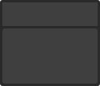
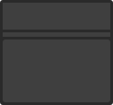

# The Strip

[Games](Library.md)

[API](API.md)

[Marketing](Marketing.md)

## User Manual

The RGB Strip is a programmable RGB LED system that functions as an ambient light, a one-dimensional gaming display, and a reactive output for sensor‑driven applications. It can be controlled by a game controller, a browser, native mobile app, or IR remote.

* Power: 5V DC USB-C socket
* Bluetooth Low Energy: 5.3 / 5.2 / 5.0 / 4.2 (legacy)
* Bluetooth Audio: 5.3 / 4.2 (legacy)
* IR remote: NEC/Samsung, RC5/RC6, Sony SIRC

### System modes

* `STANDBY` — The system is off and the LEDs are dark.
* `MENU` — The LEDs are on, displaying the game selection.
* `GAME` — The LEDs are on, displaying the active game.
* `POWERSAVE` — The system is in deep sleep and the LEDs are dark.

### Game buttons

Game buttons respond on press.

* **A, B, C, D** - primary buttons
* **X, Y, Z, W** - secondary buttons
* **Up, Down, Left, Right** - directional buttons
* **Fire, Fire2** - action buttons

### System buttons

System buttons behave differently depending on how long they are held.

* A **press** (less than 3 seconds) triggers its action when the button is released.
* A **press and hold** (3 seconds or more) triggers its action at the 3-second mark, while the button is still held. Releasing after that has no additional effect.

**Power** — Turns the system on and off; a press and hold enters `POWERSAVE` mode.

**Menu** — Displays the game selection menu; a press and hold clears the game.

**Play/Pause** — Starts and pauses the current game. Press and hold to mute or unmute the buzzer.

**BT/BLE** — Pairs the controller with a strip, or pairs the strip with a Bluetooth audio device. The button label (BT, BLE, or BT/BLE) indicates which functions are available on the model.

| Button | Multi-game console | Single-app (mains) | Single-app (battery) |
|---|---|---|---|
| Power | Required | Absent | Optional |
| Menu | Required | Absent | Absent |
| Play/Pause | Required | Absent | Absent |
| BT/BLE | Optional | Optional | Optional |

### Power

When connected to power, the system starts in `STANDBY` mode.

A press of the **Power** button turns the system on, entering `MENU` mode.

A second press of the **Power** button turns the system off, returning to `STANDBY` mode.

A press and hold of the **Power** button turns the system off and enters `POWERSAVE` mode.

In `POWERSAVE` mode, a press of the **Power** button turns on the system, entering `MENU` mode.

### Audio

**Buzzer** – makes the beeps and bleeps of the system and games. It’s loud enough to hear across the room.

**Phone socket** – delivers the high‑quality sampled audio when headphones or speakers are plugged in. Volume is handled by the user’s own speaker/headphone controls.

While a strip is paired and in `MENU` or `GAME` mode, press and hold the **Play/Pause** button to mute or unmute the buzzer.

### Pairing controller with strip

If no strip is paired, a press and hold of the **BT/BLE** button pairs with the first available strip. Once paired, the button switches to controlling audio.

To pair with a different strip, the paired strip is first put into `POWERSAVE` mode; a press and hold of the **BT/BLE** button then connects to the next available strip.

### Pairing strip with Bluetooth audio

While a strip is paired and in `MENU` or `GAME` mode, a press of the **BT/BLE** button connects the strip to the next available Bluetooth audio source. A press and hold disconnects from the current audio source.

### Game control

In `MENU` mode, the directional buttons select a game, and a press of **Play/Pause** starts it.

During a game, a press of the **Menu** button enters `MENU` mode and pauses the game. A second press returns to the paused game.

To switch games, the **Menu** button enters `MENU` mode; browsing to another game and pressing **Play/Pause** starts it. If **Play/Pause** isn't pressed, the **Menu** button simply returns to the current game.

A press and hold of the **Menu** button clears the current game; the menu is then displayed with no game loaded.

Different games may start automatically, paused, or in `DEMO` mode. For games that do not start automatically, a press of **Play/Pause** or any game button starts play.

### Corner cases

In `STANDBY` or `POWERSAVE`, a press of **Play/Pause**, **Menu**, or **BT/BLE** does nothing.

In `STANDBY` or `POWERSAVE` modes, a press and hold of **Menu** does nothing.

If no strip is paired, a press of **BT/BLE** does nothing. Only a press and hold initiates pairing.

If the strip is not connected to an audio device, a press and hold of **BT/BLE** does nothing.

In `MENU` mode with no game loaded, a press and hold of **Menu** does nothing, as there is no game to clear.

## Strips

| ID | SKU | LEDs | LED Size |
|----|-------|------|----------|
| 0x10 | Strip | 120 | 5 mm |
| 0x11 | Strip2M | 120 | 5 mm |
| 0x12 | Strip4M | 120 | 5 mm |
| 0x13 | ⭐ Strip60 | 60 | 5 mm |
| - | | | |
| 0x20 | StripMini | 120 | 3 mm |
| 0x21 | StripMini60 | 60 | 3 mm |
| - | | | |
| 0x30 | ⭐ StripRing | 24 | 5 mm |
| 0x31 | StripRing64 | 64 | 5 mm |
| | | | |
| 0x40 | StripStick | 60 | 2 mm |
| 0x41 | StripStickMini120 | 120 | 1 mm |
| | | | |
| 0xE0 | StripPanel | 8×8 | 5 mm |
| 0xE1 | ⭐ StripPanel32x8 | 32×8 | 5 mm |
| 0xE2 | ⭐ StripPanelMini64x32 | 64×32 | 3 mm |
| | | | |
| 0xF0 | StripFan | 120 | 5 mm |
| 0xF1 | StripFan60 | 60 | 5 mm |
| 0xF2 | StripFanMini | 120 | 3 mm |
| 0xF3 | StripFanMini60 | 60 | 3 mm |

## Game Controller

#### P1c

#### P1dc

#### P1ec

#### P1edc

| Connector | Description |
|-----------|----------|
| Data socket (snap) | Connecting the Strip or an extension cable |
| USB‑C socket | Power, charging, USB‑C headphones, tethering two controllers |
| Audio jack | Headphones with mic, stereo line‑in |
| Microphone (built‑in) | Voice, clap detection, audio metering |

## Expansion slots

The top face of the controller contains magnetic snap‑in expansion slots. All slots are covered by blank plates when not in use.

### Control Slot

Accepts control panels for physical input. Available in touch and arcade‑button versions.

| SKU | Description | Typical Games |
|-------|-------------------|---------------|
| **ABCD** | 4 coloured buttons (RGBY) | SimonSays, future rhythm games |
| **ABC** | 3 coloured buttons (RGB) | Stack, Moodlight, FlappyBird |
| **A** | 1 action button | Dino, Dices (single‑input games) |
| **UD** | 2 directional buttons (up / down) | Pacman (vertical strip), alternative Dices control |
| **LR** | 2 directional buttons (left / right) | Pacman (horizontal strip), 1D scrollers |
| **LRA** | 2 directional buttons (left / right) + 1 action button | |
| **UDA** | 2 directional buttons (up / down) + 1 action button | |
| **EE** | 2 rotary encoders | Moodlight, any game with knob control |

#### ABCD

#### ABC

#### A

#### UD

#### LR

#### LRA

#### UDA

#### EE

#### DPAD
<svg xmlns="http://www.w3.org/2000/svg" viewBox="0 0 133.33 100" width="133.33" height="100">
	<rect x="0" y="0" width="133.33" height="100" rx="5" ry="5" fill="#1a1a1a" />
	<rect x="5"	y="36.5" width="22" height="22" rx="3" ry="3" fill="#ffffff" data-label="L" data-code="DpadALeft" />
	<rect x="49" y="36.5" width="22" height="22" rx="3" ry="3" fill="#ffffff" data-label="R" data-code="DpadARight" />
	<rect x="27" y="14.5" width="22" height="22" rx="3" ry="3" fill="#ffffff" data-label="U" data-code="DpadAUp" />
	<rect x="27" y="58.5" width="22" height="22" rx="3" ry="3" fill="#ffffff" data-label="D" data-code="DpadADown" />
	<circle cx="107" cy="32" r="15" fill="#e74c3c" data-label="BA" data-code="ButtonA" />
	<circle cx="107" cy="68" r="15" fill="#e74c3c" data-label="BB" data-code="ButtonB" />
</svg>

### Display Slot

Accepts narrow LED display modules.

| SKU | LEDs | LED Size |
|-----|------|----------|
| OneLedDisplay | 1 | 5 mm |
| FourLedsDisplay | 4 | 5 mm |
| Strip60Display | 60 | 2 mm |
| Strip120MiniDisplay | 120 | 1 mm |

### One Led Display
<svg xmlns="http://www.w3.org/2000/svg" width="120mm" height="5mm" viewBox="0 0 120 5">
	<rect x="0" y="0" width="120" height="5" fill="#228B22" />
	<rect x="58" y="0" width="4" height="5" fill="#FFFFFF" />
	<circle cx="60" cy="2.5" r="2.1" fill="#C0C0C0" />
	<rect x="58" y="0.583" width="0.8" height="0.5" fill="#999999" />
	<rect x="58" y="3.917" width="0.8" height="0.5" fill="#999999" />
	<rect x="61.2" y="0.583" width="0.8" height="0.5" fill="#999999" />
	<rect x="61.2" y="3.917" width="0.8" height="0.5" fill="#999999" />
</svg>

### Four Led DIsplay
<svg xmlns="http://www.w3.org/2000/svg" width="120mm" height="5mm" viewBox="0 0 120 5">
	<defs>
		<g id="led5mm">
			<rect x="0.5" y="0" width="4" height="5" fill="#FFFFFF" />
			<circle cx="2.5" cy="2.5" r="2.1" fill="#C0C0C0" />
			<rect x="0.5" y="0.583" width="0.8" height="0.5" fill="#999999" />
			<rect x="0.5" y="3.917" width="0.8" height="0.5" fill="#999999" />
			<rect x="3.7" y="0.583" width="0.8" height="0.5" fill="#999999" />
			<rect x="3.7" y="3.917" width="0.8" height="0.5" fill="#999999" />
		</g>
	</defs>
	<rect x="0" y="0" width="120" height="5" fill="#228B22" />
	<use href="#led5mm" x="50" y="0" />
	<use href="#led5mm" x="55" y="0" />
	<use href="#led5mm" x="60" y="0" />
	<use href="#led5mm" x="65" y="0" />
</svg>

### Strip60 Display
<svg xmlns="http://www.w3.org/2000/svg" width="120mm" height="5mm" viewBox="0 0 120 5">
	<defs>
		<g id="led2mm">
			<rect x="0" y="0" width="2" height="2" fill="#FFFFFF" />
			<circle cx="1" cy="1" r="0.84" fill="#C0C0C0" />
		</g>
	</defs>
	<rect x="0" y="0" width="120" height="5" fill="#228B22" />
	<use href="#led2mm" x="0" y="1.5" />
	<use href="#led2mm" x="2" y="1.5" />
	<use href="#led2mm" x="4" y="1.5" />
	<use href="#led2mm" x="6" y="1.5" />
	<use href="#led2mm" x="8" y="1.5" />
	<use href="#led2mm" x="10" y="1.5" />
	<use href="#led2mm" x="12" y="1.5" />
	<use href="#led2mm" x="14" y="1.5" />
	<use href="#led2mm" x="16" y="1.5" />
	<use href="#led2mm" x="18" y="1.5" />
	<use href="#led2mm" x="20" y="1.5" />
	<use href="#led2mm" x="22" y="1.5" />
	<use href="#led2mm" x="24" y="1.5" />
	<use href="#led2mm" x="26" y="1.5" />
	<use href="#led2mm" x="28" y="1.5" />
	<use href="#led2mm" x="30" y="1.5" />
	<use href="#led2mm" x="32" y="1.5" />
	<use href="#led2mm" x="34" y="1.5" />
	<use href="#led2mm" x="36" y="1.5" />
	<use href="#led2mm" x="38" y="1.5" />
	<use href="#led2mm" x="40" y="1.5" />
	<use href="#led2mm" x="42" y="1.5" />
	<use href="#led2mm" x="44" y="1.5" />
	<use href="#led2mm" x="46" y="1.5" />
	<use href="#led2mm" x="48" y="1.5" />
	<use href="#led2mm" x="50" y="1.5" />
	<use href="#led2mm" x="52" y="1.5" />
	<use href="#led2mm" x="54" y="1.5" />
	<use href="#led2mm" x="56" y="1.5" />
	<use href="#led2mm" x="58" y="1.5" />
	<use href="#led2mm" x="60" y="1.5" />
	<use href="#led2mm" x="62" y="1.5" />
	<use href="#led2mm" x="64" y="1.5" />
	<use href="#led2mm" x="66" y="1.5" />
	<use href="#led2mm" x="68" y="1.5" />
	<use href="#led2mm" x="70" y="1.5" />
	<use href="#led2mm" x="72" y="1.5" />
	<use href="#led2mm" x="74" y="1.5" />
	<use href="#led2mm" x="76" y="1.5" />
	<use href="#led2mm" x="78" y="1.5" />
	<use href="#led2mm" x="80" y="1.5" />
	<use href="#led2mm" x="82" y="1.5" />
	<use href="#led2mm" x="84" y="1.5" />
	<use href="#led2mm" x="86" y="1.5" />
	<use href="#led2mm" x="88" y="1.5" />
	<use href="#led2mm" x="90" y="1.5" />
	<use href="#led2mm" x="92" y="1.5" />
	<use href="#led2mm" x="94" y="1.5" />
	<use href="#led2mm" x="96" y="1.5" />
	<use href="#led2mm" x="98" y="1.5" />
	<use href="#led2mm" x="100" y="1.5" />
	<use href="#led2mm" x="102" y="1.5" />
	<use href="#led2mm" x="104" y="1.5" />
	<use href="#led2mm" x="106" y="1.5" />
	<use href="#led2mm" x="108" y="1.5" />
	<use href="#led2mm" x="110" y="1.5" />
	<use href="#led2mm" x="112" y="1.5" />
	<use href="#led2mm" x="114" y="1.5" />
	<use href="#led2mm" x="116" y="1.5" />
	<use href="#led2mm" x="118" y="1.5" />
</svg>

### Strip120Mini Display
<svg xmlns="http://www.w3.org/2000/svg" width="120mm" height="5mm" viewBox="0 0 120 5">
  <defs>
    <g id="led1mm">
      <rect width="1" height="1" fill="#FFFFFF" />
      <circle cx="0.5" cy="0.5" r="0.4" fill="#C0C0C0" />
    </g>
  </defs>
  <rect width="120" height="5" fill="#228B22" />
  <use href="#led1mm" x="0" y="2.0" />
  <use href="#led1mm" x="1" y="2.0" />
  <use href="#led1mm" x="2" y="2.0" />
  <use href="#led1mm" x="3" y="2.0" />
  <use href="#led1mm" x="4" y="2.0" />
  <use href="#led1mm" x="5" y="2.0" />
  <use href="#led1mm" x="6" y="2.0" />
  <use href="#led1mm" x="7" y="2.0" />
  <use href="#led1mm" x="8" y="2.0" />
  <use href="#led1mm" x="9" y="2.0" />
  <use href="#led1mm" x="10" y="2.0" />
  <use href="#led1mm" x="11" y="2.0" />
  <use href="#led1mm" x="12" y="2.0" />
  <use href="#led1mm" x="13" y="2.0" />
  <use href="#led1mm" x="14" y="2.0" />
  <use href="#led1mm" x="15" y="2.0" />
  <use href="#led1mm" x="16" y="2.0" />
  <use href="#led1mm" x="17" y="2.0" />
  <use href="#led1mm" x="18" y="2.0" />
  <use href="#led1mm" x="19" y="2.0" />
  <use href="#led1mm" x="20" y="2.0" />
  <use href="#led1mm" x="21" y="2.0" />
  <use href="#led1mm" x="22" y="2.0" />
  <use href="#led1mm" x="23" y="2.0" />
  <use href="#led1mm" x="24" y="2.0" />
  <use href="#led1mm" x="25" y="2.0" />
  <use href="#led1mm" x="26" y="2.0" />
  <use href="#led1mm" x="27" y="2.0" />
  <use href="#led1mm" x="28" y="2.0" />
  <use href="#led1mm" x="29" y="2.0" />
  <use href="#led1mm" x="30" y="2.0" />
  <use href="#led1mm" x="31" y="2.0" />
  <use href="#led1mm" x="32" y="2.0" />
  <use href="#led1mm" x="33" y="2.0" />
  <use href="#led1mm" x="34" y="2.0" />
  <use href="#led1mm" x="35" y="2.0" />
  <use href="#led1mm" x="36" y="2.0" />
  <use href="#led1mm" x="37" y="2.0" />
  <use href="#led1mm" x="38" y="2.0" />
  <use href="#led1mm" x="39" y="2.0" />
  <use href="#led1mm" x="40" y="2.0" />
  <use href="#led1mm" x="41" y="2.0" />
  <use href="#led1mm" x="42" y="2.0" />
  <use href="#led1mm" x="43" y="2.0" />
  <use href="#led1mm" x="44" y="2.0" />
  <use href="#led1mm" x="45" y="2.0" />
  <use href="#led1mm" x="46" y="2.0" />
  <use href="#led1mm" x="47" y="2.0" />
  <use href="#led1mm" x="48" y="2.0" />
  <use href="#led1mm" x="49" y="2.0" />
  <use href="#led1mm" x="50" y="2.0" />
  <use href="#led1mm" x="51" y="2.0" />
  <use href="#led1mm" x="52" y="2.0" />
  <use href="#led1mm" x="53" y="2.0" />
  <use href="#led1mm" x="54" y="2.0" />
  <use href="#led1mm" x="55" y="2.0" />
  <use href="#led1mm" x="56" y="2.0" />
  <use href="#led1mm" x="57" y="2.0" />
  <use href="#led1mm" x="58" y="2.0" />
  <use href="#led1mm" x="59" y="2.0" />
  <use href="#led1mm" x="60" y="2.0" />
  <use href="#led1mm" x="61" y="2.0" />
  <use href="#led1mm" x="62" y="2.0" />
  <use href="#led1mm" x="63" y="2.0" />
  <use href="#led1mm" x="64" y="2.0" />
  <use href="#led1mm" x="65" y="2.0" />
  <use href="#led1mm" x="66" y="2.0" />
  <use href="#led1mm" x="67" y="2.0" />
  <use href="#led1mm" x="68" y="2.0" />
  <use href="#led1mm" x="69" y="2.0" />
  <use href="#led1mm" x="70" y="2.0" />
  <use href="#led1mm" x="71" y="2.0" />
  <use href="#led1mm" x="72" y="2.0" />
  <use href="#led1mm" x="73" y="2.0" />
  <use href="#led1mm" x="74" y="2.0" />
  <use href="#led1mm" x="75" y="2.0" />
  <use href="#led1mm" x="76" y="2.0" />
  <use href="#led1mm" x="77" y="2.0" />
  <use href="#led1mm" x="78" y="2.0" />
  <use href="#led1mm" x="79" y="2.0" />
  <use href="#led1mm" x="80" y="2.0" />
  <use href="#led1mm" x="81" y="2.0" />
  <use href="#led1mm" x="82" y="2.0" />
  <use href="#led1mm" x="83" y="2.0" />
  <use href="#led1mm" x="84" y="2.0" />
  <use href="#led1mm" x="85" y="2.0" />
  <use href="#led1mm" x="86" y="2.0" />
  <use href="#led1mm" x="87" y="2.0" />
  <use href="#led1mm" x="88" y="2.0" />
  <use href="#led1mm" x="89" y="2.0" />
  <use href="#led1mm" x="90" y="2.0" />
  <use href="#led1mm" x="91" y="2.0" />
  <use href="#led1mm" x="92" y="2.0" />
  <use href="#led1mm" x="93" y="2.0" />
  <use href="#led1mm" x="94" y="2.0" />
  <use href="#led1mm" x="95" y="2.0" />
  <use href="#led1mm" x="96" y="2.0" />
  <use href="#led1mm" x="97" y="2.0" />
  <use href="#led1mm" x="98" y="2.0" />
  <use href="#led1mm" x="99" y="2.0" />
  <use href="#led1mm" x="100" y="2.0" />
  <use href="#led1mm" x="101" y="2.0" />
  <use href="#led1mm" x="102" y="2.0" />
  <use href="#led1mm" x="103" y="2.0" />
  <use href="#led1mm" x="104" y="2.0" />
  <use href="#led1mm" x="105" y="2.0" />
  <use href="#led1mm" x="106" y="2.0" />
  <use href="#led1mm" x="107" y="2.0" />
  <use href="#led1mm" x="108" y="2.0" />
  <use href="#led1mm" x="109" y="2.0" />
  <use href="#led1mm" x="110" y="2.0" />
  <use href="#led1mm" x="111" y="2.0" />
  <use href="#led1mm" x="112" y="2.0" />
  <use href="#led1mm" x="113" y="2.0" />
  <use href="#led1mm" x="114" y="2.0" />
  <use href="#led1mm" x="115" y="2.0" />
  <use href="#led1mm" x="116" y="2.0" />
  <use href="#led1mm" x="117" y="2.0" />
  <use href="#led1mm" x="118" y="2.0" />
  <use href="#led1mm" x="119" y="2.0" />
</svg>

### Accessory Slots

Accepts accessory modules for sensors, screens, and alternative displays. A module occupies one slot; wide modules span both.

| SKU | Description |
|-----|-----------------|
| RingDisplayModule | LED ring (NeoPixel) |
| ScreenModule | TFT/OLED display (single slot) |
| RoundScreenModule | Round TFT/OLED display (single slot) |
| WideScreenModule | Wide TFT/OLED display (spans both middle slots) |
| MotionModule | Accelerometer, gyroscope, magnetometer |
| NavigationModule | Accelerometer, gyroscope, magnetometer, GPS, barometric pressure sensor |
| EnvironmentModule | Temperature, humidity, barometric pressure sensors |
| ProximityModule | Time‑of‑flight / proximity sensor |

### Converter & Cables

| SKU | Description |
|-----|-------------|
| Converter C1 | Magnetic pogo plug to USB‑C female adapter (included with all Strip units) |
| Extension E1 | 1‑metre cable, magnetic pogo connectors at both ends |
| Extension E2 | 2‑metre cable, magnetic pogo connectors at both ends |
| Injector I1 | Mid‑strip power injector, magnetic pogo connectors at both ends, USB‑C female port |

### Configurations

#### Ambient Light System

* Components: One Strip unit with a Converter C1
* Setup: Connect the Converter C1 to the Strip's data magnetic socket, insert a USB‑C power adapter, and control via the mobile app.

#### Single‑Player Gaming System

* Components: One Strip unit, one Converter C1, one P1 controller (any model)
* Optional: Extension E1 or E2 cable for greater distance between the player and the Strip.

#### Two‑Player Gaming System

* Components: One Strip unit, one Converter C1, two P1 controllers
* Optional: Two Extension E1 or E2 cables for player comfort.

#### Multi‑Unit Deployment

* Independent Units: Each gaming system operates autonomously.
* Scalability: Multiple complete systems can be deployed side‑by‑side.
* Example (10‑lane setup): 10× Strip4M, 10× Converter C1, 20× P1 controllers, 20× Extension E2 cables.

# Hacker Manual

### Display Slot Pinout

| Pin | Function |
|---|---|
| 1 | VCC |
| 2 | DATA |
| 3 | GND |

### Accessory Slot Pinout

| Pin | Name |
|-----|------|
| 1 | VCC |
| 2 | DATA |
| 3 | SCLK |
| 4 | MOSI |
| 5 | MISO |
| 6 | CS |
| 7 | CS2 |
| 8 | D/C	|
| 9 | RST	|
| 10 | GND	|

### Control Slot Pinout

| Pin | Name |
|---|---|
| 1 | VCC |
| 2 | Left Button|
| 3 | Right Button |
| 4 | Up Button |
| 5 | Down Button |
| 6 | Action Button |
| 7 | Action 2 Button |
| 8 | Button A |
| 9 | Button B |
| 10 | Button C |
| 11 | Button D |
| 12 | Encoder Button |
| 13 | Encoder clock |
| 14 | Encoder data |
| 15 | Encoder 2 Button|
| 16 | Encoder 2 clock |
| 17 | Encoder 2 data |
| 18 | Joystick X |
| 19 | Joystick Y |
| 20 | GND	|

### Data connector pinout

| Pin | Name | Description |
|-----|------|-------------|
| 1	 | +5V	| 5 V DC power input |
| 2	 | GND	| Common ground |
| 3	 | DATA | Bidirectional data |
| 4	 | AUDIO | Global audio pcm stream (same mix on both ends) |
| 5	 | LOCAL_AUDIO | Local audio pcm stream (spatial mix optimized for this end) |

